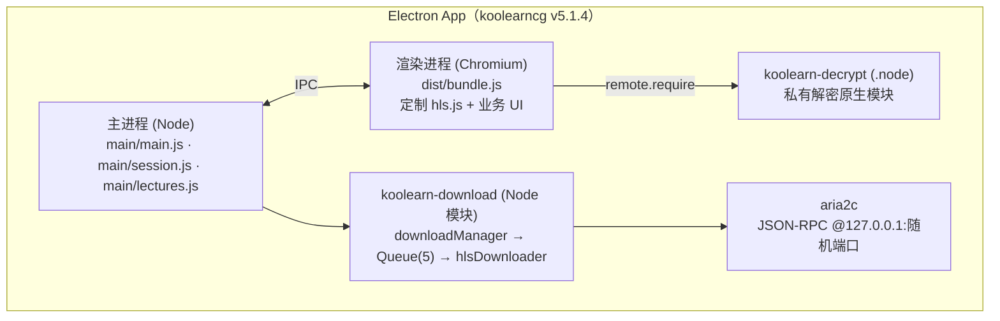
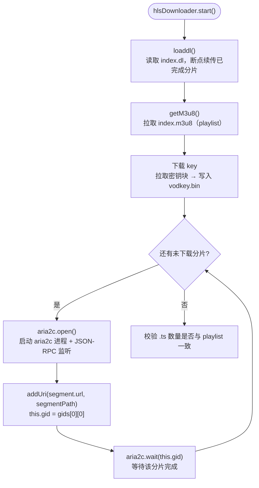
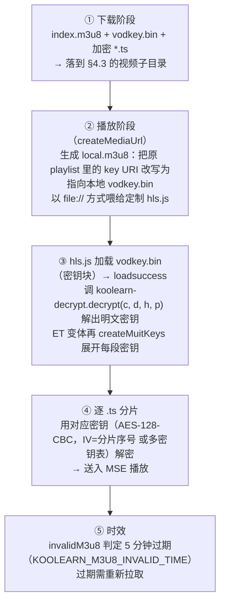
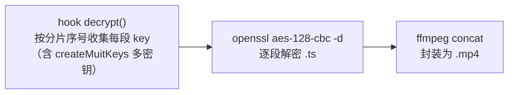
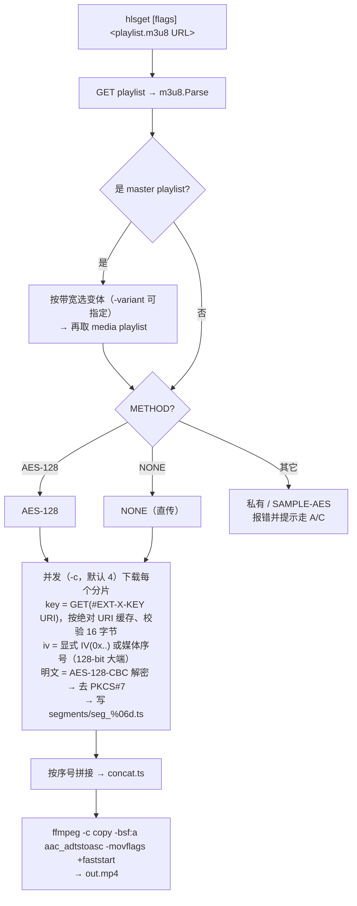
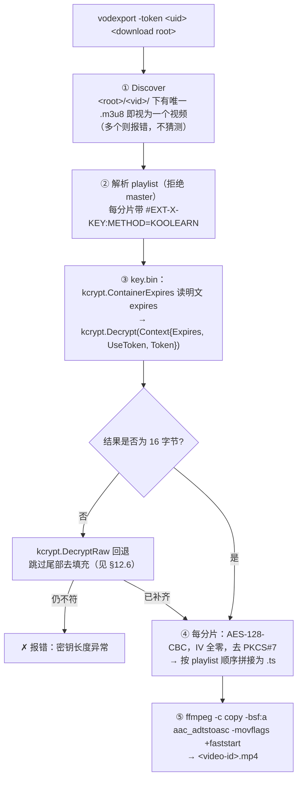
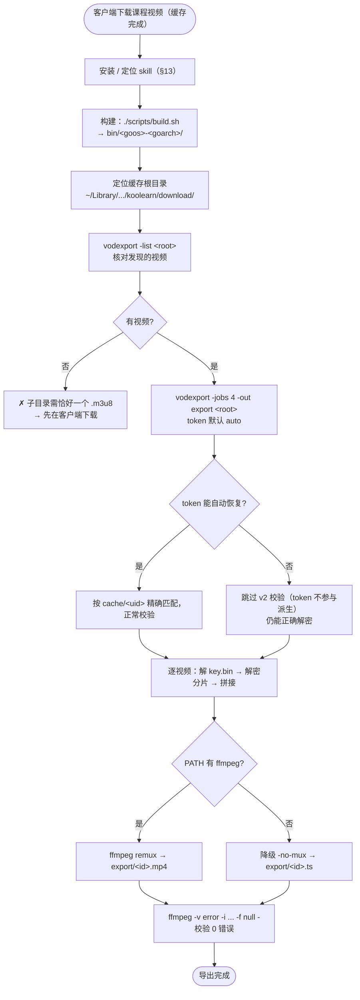

# koolearn-crypt

> 新东方在线桌面客户端（`koolearncg` / "新东方大学考试"）的**下载与私有加密方案**逆向分析文档。
>
> 本仓库先以**研究与文档**梳理 App 的 HLS 下载、本地存储结构与 `koolearn-decrypt` 私有加密算法；
> 在此基础上已完成两条 Go 实现路线：
> - **路线 B**：标准 HLS AES-128 下载 → 解密 → 合并（§10，纯标准库 + ffmpeg remux，端到端验证通过）；
> - **路线 C**：完整复刻 `decryptByPlan` 私有解密流程（§11），已与原生模块**逐字节对拍**通过。
> 仅剩路线 A（运行时 dump 密钥）作为备选。

---

## 目录

- [0. 合规与免责声明](#0-合规与免责声明)
- [1. App 概览](#1-app-概览)
- [2. 整体架构](#2-整体架构)
- [3. 下载子系统](#3-下载子系统)
  - [3.1 HLS 视频下载（koolearn-download + aria2c）](#31-hls-视频下载koolearn-download--aria2c)
  - [3.2 普通文件下载（Electron will-download）](#32-普通文件下载electron-will-download)
- [4. 下载存储位置与目录结构](#4-下载存储位置与目录结构)
- [5. 私有加密方案（koolearn-decrypt）](#5-私有加密方案koolearn-decrypt)
  - [5.1 模块与 API](#51-模块与-api)
  - [5.2 `KEY.` 容器格式](#52-key-容器格式)
  - [5.3 密钥派生](#53-密钥派生)
  - [5.4 `decryptByPlan` 多轮组合算法](#54-decryptbyplan-多轮组合算法)
  - [5.5 PLANS_DIC 字典与跳转表](#55-plans_dic-字典与跳转表)
  - [5.6 密码原语清单](#56-密码原语清单)
  - [5.7 渲染层调用链（定制 hls.js）](#57-渲染层调用链定制-hlsjs)
- [6. 播放流程（local.m3u8）](#6-播放流程localm3u8)
- [7. 导出为 MP4 的可行性评估](#7-导出为-mp4-的可行性评估)
- [8. 逆向工程记录（符号 / 地址速查）](#8-逆向工程记录符号--地址速查)
- [9. 后续 TODO](#9-后续-todo)
- [10. 路线 B 实现：hlsget（Go）](#10-路线-b-实现hlsgetgo)
- [11. 路线 C 实现：kcrypt（Go，复刻 decryptByPlan）](#11-路线-c-实现kcryptgo复刻-decryptbyplan)
- [12. 路线 C 实战：vodexport（缓存导出为 MP4）](#12-路线-c-实战vodexport缓存导出为-mp4)
- [13. Skill 安装方法](#13-skill-安装方法)
- [14. 程序完整用法](#14-程序完整用法)
- [15. 端到端导出全流程（Workflow 与流程图）](#15-端到端导出全流程workflow-与流程图)

---

## 0. 合规与免责声明

- 本项目仅用于**个人学习与安全研究**，分析对象为用户本地已合法安装的客户端。
- App 内的视频/课件受版权与 DRM 保护，导出行为可能违反**服务条款（ToS）**及相关法律法规。
- 任何基于本文档的实现，请仅在**已获授权 / 自有内容**的前提下使用，风险自担。

---

## 1. App 概览

| 项 | 值 |
|---|---|
| 包名（package.json `name`） | `koolearncg` |
| 版本 | `5.1.4` |
| 入口 | `./main/main.js`（Electron 主进程） |
| 运行时 | Electron（Chromium + Node.js） |
| `global.appname` | `koolearn`（在 `main.js:38` 设置，决定数据目录名） |
| `appid` | `com.koolearn.wm` |
| `gappname` | `新东方大学考试` |
| macOS 安装路径 | `/Applications/新东方大学考试.app` |
| `app.asar` MD5 | `33b167d692358d39fff38351cfe407b3`（28,989,758 字节） |

**关键原生依赖（node_modules）：**

| 模块 | 版本 | 作用 |
|---|---|---|
| `koolearn-download` | `0.7.3` | "a hls download manager"，基于 aria2c 的 m3u8 分片下载器 |
| `koolearn-decrypt` | `0.3.3` | C++/NAN 原生插件（`decrypt.node`），私有解密算法 |
| `koolearn-m3u8-parser` | — | m3u8 解析 |
| `nedb` | — | 嵌入式 NoSQL（settings.db / download.db / keys.db / index.dl） |

**渲染层：** `dist/bundle.js`（约 6.7 MB / 786 行压缩代码），内含**定制版 hls.js**（`isKoolearn` / `isKoolearnET` 标记）。

---

## 2. 整体架构



App 存在**两套并行的下载机制**：

1. **HLS 视频下载** —— 走 `koolearn-download` + `aria2c`，下载加密的 `.ts` 分片，落盘后由播放器实时解密。
2. **普通文件下载**（PDF/讲义/附件等）—— 走 Electron 原生 `will-download`，配合 `session.js` 注入响应头。

---

## 3. 下载子系统

### 3.1 HLS 视频下载（koolearn-download + aria2c）

**模块结构（`node_modules/koolearn-download/src/`）：**

| 文件 | 行数 | 职责 |
|---|---|---|
| `downloadManager.ts` | — | 单例；`Queue(concurrency: 5)`；`create()` 对 `Hls` 类型 `new hlsDownloader` |
| `hlsDownloader.ts` | 662 | HLS 下载核心（见下方流程） |
| `aria2c.ts` | 317 | aria2c 引擎封装（JSON-RPC 控制） |
| `queue.ts` | 217 | 并发队列 |
| `m3u8.ts` | — | m3u8 解析/改写 |
| `database.ts` | — | nedb 持久化（`index.dl` 分片进度） |
| `utility.ts` | 270–335 | `httpEx.getText/get`（node-fetch）；`http.checkJson` 检测密钥是否返回 JSON 错误 |
| `downloadStatus.ts` / `downloadType.ts` / `downloadEvents.ts` / `downloadError.ts` | — | 状态机 / 类型 / 事件 / 错误定义 |

**`hlsDownloader.start()` 流程：**



**`aria2c.ts` 引擎要点：**

```js
// 启动参数
const args = [
  `--rpc-listen-port=${this._port}`,   // 随机端口
  "--enable-rpc",
  "--rpc-allow-origin-all",
  "--allow-overwrite",
  '--remove-control-file=true',        // 不保留 .aria2 控制文件
];
const proxy = process.env["KOOLEARN-DOWNLOAD-PROXY"];  // 可选代理
```

- 二进制路径：`bin/{platform}/{arch}/aria2c`；**darwin 仅提供 x64**（3.6 MB）。
- 控制方式：JSON-RPC over HTTP，`127.0.0.1:{随机端口}/jsonrpc`。

**要点：** 下载下来的 `.ts` 分片是**密文**，`koolearn-download` 本身**不做解密**，解密发生在播放时（见 §5、§6）。

### 3.2 普通文件下载（Electron will-download）

**`main/main.js`（470–568 行）：**

| 位置 | 函数 | 作用 |
|---|---|---|
| L38 | — | `global.appname = 'koolearn';`（决定数据目录名，**关键**） |
| L526 | `webContentDownload` | 注册 `will-download` 并触发 `downloadURL` |
| L538 | `webContentWillDownload` | 监听 `updated` / `done` 事件 |
| L565 | `webContentSendStatus` | 通过 IPC 回传 `(url, status, receivedBytes, totalBytes)` |

IPC 通道：`newDownloadTask`、`webContentDownload`。

**`main/session.js`：**

- `onHeadersReceived`：注入 `Content-Disposition`（处理 `attachmentPdf` / `attachmentFileName`，读取自定义头 `xdf-download-filename`）。
- `onBeforeRequest`：强制 HTTPS（`vdn.*.koopass.com`）。
- 改写 `User-Agent`。

**`main/lectures.js`（内容脚本）：**

- 拦截 `.j-operate-download` 点击 → 追加 `xdf-download-filename` → `window.open` 触发下载。

---

## 4. 下载存储位置与目录结构

### 4.1 根路径推导

```
getAppPath()          # bundle.js @5932091
  darwin  = [HOME, "Library/Application Support/", appname, appname, ...]
  appname = "koolearn"（来自 main.js:38 的 global.appname）

getDefaultSettings()  # bundle.js @5949592
  const e = join(getAppPath(), "download")
  downloadSetting: { path: e, isAuto: true, definition: "" }
```

**各平台默认下载根目录：**

| 平台 | 路径 |
|---|---|
| macOS | `~/Library/Application Support/koolearn/koolearn/download/` |
| Windows | `%APPDATA%\koolearn\koolearn\download\` |

> 注意路径里 **`koolearn/koolearn` 重复两层**：外层是 `getAppPath()` 的固定结构，内层是 appname。

### 4.2 用户机器实测

```
~/Library/Application Support/koolearncg/     # Electron userData（Cache/Cookies/…）
~/Library/Application Support/koolearn/koolearn/
    ├─ appstatistic
    ├─ cache
    │    └─ 110607776/settings.db            # 按 user_id 分目录
    └─ download/                             # 空（该机器尚未下载过视频）

cache/110607776/settings.db 内容:
    downloadSetting.path = "/Users/ariakage/Library/Application Support/koolearn/koolearn/download"
    definition = "HD"
    isAuto = true
    download.db / keys.db 均 0 字节（未下载过）
```

### 4.3 单个视频的目录命名

```js
// getPath() @ bundle.js 6000813
t = (yield getSettings()).downloadSetting.path;
n = `${productId.toString(32)}${orderNo}${courseId.toString(32)}${nodeId.toString(32)}`;
path = join(t, n);
```

即：`productId`、`courseId`、`nodeId` 转 **32 进制**，与 `orderNo` 拼接成一个子目录名。

**子目录内文件构成：**

| 文件 | 说明 |
|---|---|
| `index.m3u8` | 原始 playlist（分片列表 + `#EXT-X-KEY`） |
| `vodkey.bin` | 下载下来的**密钥块**（`KEY.` 容器格式，见 §5.2） |
| `*.ts` | **加密的**视频分片（密文） |
| `index.dl` | nedb，分片下载进度（断点续传） |
| `local.m3u8` | 播放用改写版（key URI 指向本地 `vodkey.bin`，见 §6） |

### 4.4 修改下载路径

- UI：设置 → 下载路径 → 浏览（`selectDirectory` @ bundle.js 6545814，`remote.dialog.showOpenDialog({properties:["openDirectory"]})`）。
- 持久化：按 `user_id` 存于 nedb `settings.db` 的 `downloadSetting.path`。

---

## 5. 私有加密方案（koolearn-decrypt）

> 对 `node_modules/koolearn-decrypt/build/Release/decrypt.node`（Mach-O x86_64，**符号未 strip**）的完整逆向结论。
>
> **它不是 CryptoPP**，而是**手写 AES + MD5 + 三种古典密码的多轮组合**自定义方案。

### 5.1 模块与 API

`koolearn-decrypt/main.js`：

```js
libdecrypt = require('./build/Release/decrypt.node');
module.exports.decrypt = function (data, key, token, expires) {
    return libdecrypt.decrypt(data, key, token, expires);
};
```

**`decrypt(data, key, token, expires)` 四个参数：**

| 参数 | 类型 | 含义 |
|---|---|---|
| `data` | Buffer | `KEY.` 容器密文（即 `vodkey.bin` 内容 / 密钥块） |
| `key` | Buffer | 硬编码盐：ET 变体为 `"5wqPBk89IkGBxXZy"`，否则为空 Buffer |
| `token` | Buffer | 用户 token（`user_id`） |
| `expires` | Integer | 时间戳；不大于魔数 `0x58D10EEF` 时回退为 `time(NULL)*1000`（毫秒） |

返回：`{ code, result }`（`CreateResult` @0x1a70 用 `v8::Integer::New` + `node::Buffer::Copy` + `Object::Set` 组装）。

### 5.2 `KEY.` 容器格式

容器以 6 字节头开始（`headWriteInto` @0xe1a0）：

```
offset 0..3   magic   = 0x2e59454b（小端 = ASCII "KEY."）
offset 4..5   version = 1 或 2（小端 uint16）
```

其后是**连续的 TLV 标签**，每个标签以 2 字节小端 `tagType` 开头：

| tagType | 结构体 | 线格式（各长度字段均为小端） |
|---|---|---|
| `0x0001` | `encryptTag` | `type(2) + EncryptType(1) + PlansLen(2) + plans + KeyLen(2) + key` |
| `0x0002` | `tokenTag` | `type(2) + token(16)` |
| `0x0003` | `expiresTag` | `type(2) + expires(8) + expiresData(16)` |
| `0x00ff` | `dataTag` | `type(2) + len(4) + data` |
| `0xffff` | `hashTag` | `type(2) + hash(16)` |

`decrypt_parse` @0x2540 的流程：

1. 校验 magic 与 version（否则返回 `-2` / `-3`），循环解析标签，**最多 8 个**（第 9 个起报 `-2`）。
2. `createKey` 派生 16 字节密钥（见 §5.3）。
3. version 2 时依次校验：`hashTag`（`MD5(SHA1_LE(除 hashTag 外的全部字节))`，不符返回 `-6`）、
   `tokenTag`（`MD5(token)`，不符返回 `-4`）、`expiresTag`（解密后比对，且不得早于当前时间，否则 `-5`）。
4. 用 `getData` → `decryptByPlan` 解密 `dataTag`，返回明文。

`getData` @0xe140 仅在 `EncryptType == 1` 时解密，否则返回空标签。

错误码：`-2` magic/标签数 · `-3` 版本 · `-4` token · `-5` expires · `-6` hash。

### 5.3 密钥派生

`createKey` @0xdc50 把若干字段拼进一个缓冲区再做一次 MD5，输出即 16 字节密钥：

```
buf = [e_tag->Key（klen 字节）]   ← 每个容器独立的 16 字节随机 key
      [basekey（keyLen 字节）或 内置常量 "752500f5fa6b6b8f"]
      [0x20 处写 expires（小端 8 字节）]
      [0x28 处写 token（16 字节）]

密钥 = MD5(buf)
```

细节：

- `bufLen`：`expires > 0` 时为 `klen + 40`，否则 `klen + 16`。
- `useKey` 为真时拼接调用方传入的 basekey；为假时用内置常量 `752500f5fa6b6b8f`。
- `expires` 与 `token` 的写入使用**固定偏移 0x20 / 0x28**，与 `klen` 无关：短 `klen` 会留下零填充，超长 token 会被 `bufLen` 截断——两者都被原样复刻。

`createPartKey` @0x7400：用 `rand()` 填充随机字节（**加密侧**生成每容器盐用；解密侧不参与）。

### 5.4 `decryptByPlan` 多轮组合算法

`decryptByPlan` @0x7140 是核心解密器。输入为 `encryptTag`（含 `plans` 与每容器随机 `key`）、派生出的 16 字节 `key`、以及待解密 `data`。逻辑为**按 plan 列表逆序施加密码原语**：

```
输入: plans[]（4..8 字节，每字节 ∈ [0,31]）、key(16B)、data

buf = copy(data)
for i = len(plans)-1 downto 0:
    sel = PLANS_DIC[plans[i]]        # 32 字节常量表 → 选择子 0..3
    按 sel 只执行一种原语（均用同一个 16 字节 key）:
        sel=0 → Caesar_Decrypt（逐字节减 key[i%len(key)]，模 256）
        sel=1 → my_RC4        （标准 RC4 KSA + PRGA，原地 XOR）
        sel=2 → Fence_Decrypt （列/行转置，网格几何由 sum(key) 决定）
        sel=3 → AesDecryptECB （AES-128-ECB 逐 16B 块原地解密）

最后: unpadFuzzy(buf)   # 宽松 PKCS#7 去填充
```

> **要点**：与“先 AES 再古典密码”的直觉相反——每轮**只执行一种**原语（由 `sel` 选定），`sel=3` 才是 AES-128-ECB；解密为**逆序**，`encryptByPlan` 则为**正序**且先做 PKCS#7 填充。

**宽松去填充**（`unpadFuzzy`）：末字节 `>16` 或 `==0` 时**原样返回**；否则令 `finalLen = n - last`，仅当尾部 `last` 个字节全部等于 `last` 时才截断，否则保持原样。

### 5.5 PLANS_DIC 字典与跳转表

**`PLANS_DIC` @0xed30**（32 字节查找表，把每轮的 plan 字节映射成密码选择子 0–3）：

```
03 01 00 00 03 00 02 03 03 01 03 03 01 01 01 02
03 03 00 02 00 00 01 02 03 00 03 03 02 00 01 03
```

**跳转表 @0x737c**（4 项，相对基址）：

| sel | 目标 |
|---|---|
| 0 | `Caesar_Decrypt` |
| 1 | `my_RC4` |
| 2 | `Fence_Decrypt` |
| 3 | `AesDecryptECB`（AES-128-ECB，即 0x71e0） |

### 5.6 密码原语清单

| 类别 | 函数 |
|---|---|
| 手写 AES | `aes_gen_tables` / `aes_set_key` / `KeyExpansion` / `SubWord` / `RotWord_Right` / `InvMixColumnsDecKey`；模式 `ECB / CBC / PCBC / CRT(CTR) / CFB / OFB`；S-box @0xed80（标准 `63 7c 77 7b f2 6b …`） |
| 流密码 | `my_RC4` / `re_RC4` |
| 古典/混淆 | `Caesar_Encrypt/Decrypt`（凯撒）、`Fence_Decrypt`（栅栏）、`XOR2_64`、`padding` |
| 哈希 | `GetMd5`（MD5）、SHA1；`createHashTag = MD5(SHA1_LE(data))`（SHA-1 摘要按 host 小端重排后再 MD5） |
| 密钥/编排 | `decryptByPlan`、`createKey`、`createPartKey`、`createHeader` |
| TLV 标签 | `create/read/writeInto` × `Encrypt/Data/Expires/Token/Hash` Tag |
| 导入 stub | `malloc`(0xe9be) / `free`(0xe9b8) / `memcpy`(0xe9ca) / `memset`(0xe9d0) / `rand`(0xe9d6) / `srand`(0xe9dc) / `time`(0xe9e2) / `IntegerValue`(0xe988) / `Buffer::Data`(0xe97c) / `Buffer::Length`(0xe982) |

### 5.7 渲染层调用链（定制 hls.js）

**解密核心 @ bundle.js 943494**（hls.js `loadsuccess` 回调，即密钥块下载成功后）：

```js
d = l.isKoolearnET ? Buffer.from("5wqPBk89IkGBxXZy") : Buffer.from(""),
h = Buffer.from(this.hls.userConfig.token || ""),
p = this.hls.userConfig.timestamp,
f = require("electron").remote.require("koolearn-decrypt").decrypt(c, d, h, p);
if (l.isKoolearnET)
    u = this.createMuitKeys(f.result.toString("utf8"), "initSegment" === s.sn ? 0 : s.sn);
```

- `c` = 下载到的密钥块（`KEY.` 容器密文）。
- `f.result` = 解密后的明文密钥串。
- ET 变体进一步调 `createMuitKeys` 展开**多密钥**。

**`createMuitKeys` @ bundle.js 944520**：把明文解析为 `[min,max]key;...` 形式的 **MutiKey 映射**（不同分片区间用不同密钥）。

**其它相关位置：**

| 位置 | 内容 |
|---|---|
| @5929287 | `wt.appname = getGlobal("appname")`，`appid="com.koolearn.wm"`，`gappname="新东方大学考试"` |
| @5932091 | `getAppPath()`（darwin 路径拼接） |
| @5949592 | `getDefaultSettings()`（默认下载路径） |
| @6000813 | `getPath()`（单视频目录命名，见 §4.3） |
| @6007059 | `invalidM3u8`：`KOOLEARN_M3U8_INVALID_TIME \|\| 3e5`（**5 分钟过期**） |
| @6545814 | `selectDirectory`（下载路径选择对话框） |

> 另存在 **WASM 解密路径**（备用），主路径为上述原生 `decrypt.node`。

---

## 6. 播放流程（local.m3u8）



**关键结论：** 磁盘上的 `.ts` 始终是密文，**解密只发生在播放时的内存中**，密钥由 `koolearn-decrypt` 现场派生，不落明文。

---

## 7. 导出为 MP4 的可行性评估

直接用 `ffmpeg` 处理磁盘文件**不可行**——因为 `.ts` 是私有加密的密文，且密钥不在磁盘上（播放时由原生模块现场派生）。

| 方案 | 思路 | 难度 | 评价 |
|---|---|---|---|
| **A. 运行时 dump 密钥** | Hook `koolearn-decrypt.decrypt`，在 App 播放时把真实密钥/多密钥表导出，再离线解密合并 | 中 | **最实际**，绕开算法细节 |
| **B. 标准 AES-128 分支** ✅ 已实现 | 标准 HLS AES-128（显式 IV 或 IV=序号）直接下载 + 解密 + 合并 | 低 | 见 §10 `hlsget`；仅适用于非私有加密内容 |
| C. 完整逆向 decrypt.node ✅ 已实现 | 复刻 `decryptByPlan` 多轮组合算法，独立离线派生密钥 | 高 | 见 §11 `kcrypt`（已与原生模块逐字节对拍）+ §12 `vodexport`（已全量导出） |
| D. 录屏兜底 | 播放时屏幕/音频采集 | 低 | 质量损失，最后手段 |

**方案 A 推荐流程：**



---

## 8. 逆向工程记录（符号 / 地址速查）

`decrypt.node`（Mach-O x86_64，未 strip）：

| 符号 | 地址 | 说明 |
|---|---|---|
| `Method` | 0x1be0 | JS 入口（NAN_METHOD），校验 argc>3，`expires` 经 `0x58D10EEF` 兜底后写入 `ctx` |
| `Init` | 0x1ef0 | 模块注册 |
| `CreateResult` | 0x1a70 | 组装 `{code, result}` 返回对象 |
| `decrypt_parse` | 0x2540 | 解析 `KEY.` 容器 + 派生密钥（核心校验） |
| `parse_release` | 0x2920 | 释放解析上下文 |
| `decryptByPlan` | 0x7140 | 多轮组合解密核心 |
| `createKey` | 0xdc50 | 拼接 `e_tag.key ‖ basekey/内置常量 ‖ expires@0x20 ‖ token@0x28` → MD5 → 16B 密钥 |
| `createPartKey` | 0x7400 | `rand()+1` 填充随机字节 |
| `createHeader` | 0x7440 | 写 `KEY.` 魔数 + version=2 |
| `getExpires` | 0xe0f0 | 抽取 expires（8B 整数） |
| case3 目标 | 0x71e0 | `AesDecryptECB`（AES-128-ECB，PLANS_DIC sel=3） |
| `PLANS_DIC` | 0xed30 | 32B 查找表（plan 字节 → 选择子 0–3） |
| 跳转表 | 0x737c | 4 项：Caesar / RC4 / Fence / AesDecryptECB |
| AES S-box | 0xed80 | 标准 S-box |

**关键魔数：**

| 魔数 | 含义 |
|---|---|
| `0x2e59454b` | ASCII `KEY.`（容器头，小端） |
| version `2` | 容器版本（2 字节） |
| `0x58D10EEF` | Unix 时间 1490095855（2017-03-21 11:30:55 UTC），`expires` 兜底阈值：`expires > 0x58D10EEF ? expires : time(NULL)*1000` |
| `"5wqPBk89IkGBxXZy"` | ET 变体硬编码盐（16 字节） |

**逆向工具链：** Apple `objdump`（LLVM）+ `otool` + `nm`（无 radare2/ghidra，符号未 strip 故足够）。

---

## 9. 后续 TODO

> 路线 B（标准 AES-128）与路线 C（复刻 `decryptByPlan`）均已用 Go 实现并通过验证，见 §10 / §11。以下为剩余候选方向：

- [ ] **方案 A**：编写 `decrypt` hook 脚本，运行时 dump 真实密钥 / 多密钥表（现为备选）。
- [x] 「解密 `.ts` + `ffmpeg` 合并为 `.mp4`」的完整流程：已由路线 C 实现为 `cmd/vodexport`，见 §12。
- [x] **方案 C**：补全 `decryptByPlan` 字节级细节，确认 `sel=3`（`AesDecryptECB`），复刻离线密钥派生。见 §11。
- [x] 校验 `KEY.` 容器的完整 TLV 字段布局（各 tag 的 type/length/value 编码）。见 §5.2。
- [ ] 补充 `koolearn-m3u8-parser` 的解析细节。
- [ ] （可选）WASM 解密路径的逆向。

---

## 10. 路线 B 实现：hlsget（Go）

针对**标准 HLS AES-128**（非 koolearn 私有加密）的下载 + 解密 + 合并工具。**纯 Go 标准库**实现（无第三方依赖），最后一步调 `ffmpeg` remux 为 MP4。

### 10.1 目录结构

```
koolearn-crypt/
├─ go.mod                     # module koolearn-crypt（go 1.23）
├─ cmd/hlsget/main.go         # CLI 入口：flag 解析、进度、信号处理
├─ internal/
│  ├─ m3u8/playlist.go        # m3u8 解析：master/media、EXT-X-KEY、IV、媒体序号
│  │  └─ playlist_test.go
│  └─ hls/
│     ├─ crypto.go            # AES-128-CBC 解密 + IV 推导 + PKCS#7 去填充
│     ├─ crypto_test.go
│     ├─ fetch.go             # HTTP 拉取器：自定义头、重试、相对 URI 解析
│     ├─ job.go               # 编排：拉表→选变体→并发下载解密→有序拼接
│     └─ mux.go               # 调 ffmpeg remux 为 mp4（-c copy）
└─ scripts/e2e-test.sh        # 端到端验证：本地造加密 HLS 并逐字节比对
```

### 10.2 核心流程



### 10.3 构建与用法

```bash
go build -o bin/hlsget ./cmd/hlsget

# 自动选最高码率变体，解密并 remux 为 mp4
./bin/hlsget -o out.mp4 "https://host/master.m3u8"

# 带鉴权头（koolearn 会改写 UA，且可能需要 Referer / Cookie）
./bin/hlsget -o out.mp4 -c 8 \
  -H 'Referer: https://host/' -H 'Cookie: sid=abc' \
  "https://host/index.m3u8"

# 只解密拼接为 .ts、不 remux，并保留分片
./bin/hlsget -no-mux -keep-segments -o out.ts "https://host/index.m3u8"
```

主要 flag：`-o` 输出 · `-c` 并发 · `-variant` 变体序号 · `-H` 追加请求头（可重复）· `-retries` · `-timeout` · `-no-mux` · `-keep-segments` · `-q` 静默。

### 10.4 验证

- **单元测试** `go test ./...`：
  - `internal/m3u8`：media/master 解析、带引号含逗号的 URI、密钥轮换、`METHOD=NONE`、空表报错。
  - `internal/hls`：AES-128-CBC 往返、非法 PKCS#7 拒绝、显式/序号/短 IV 推导。
- **端到端** `bash scripts/e2e-test.sh`：
  - 本地 ffmpeg 生成明文 HLS（3 分片）→ openssl AES-128-CBC 加密 → 起 HTTP 服务 → 跑 hlsget。
  - 覆盖 **显式静态 IV** 与 **IV=媒体序号** 两条分支。
  - 断言：解密拼接结果与明文源 **md5 逐字节一致**；remux 的 mp4 时长 ≈6s。
  - 结果：**ALL PASS**（两场景 decoded md5 均等于 truth md5 `9a943370…`）。

### 10.5 边界与注意

- 仅处理**标准 AES-128**。koolearn 私有加密（`KEY.` 容器 / `decryptByPlan` / 分段多密钥）**不适用**——遇到非 AES-128 的 METHOD 会明确报错，需走路线 A（运行时 dump 密钥）或 C（复刻算法）。
- 尚未实现：`#EXT-X-BYTERANGE`、`SAMPLE-AES`、fMP4（`#EXT-X-MAP` init 段）、直播（仅 VOD）、断点续传。
- 合规见 §0。

---

## 11. 路线 C 实现：kcrypt（Go，复刻 decryptByPlan）

`internal/kcrypt` 是 `koolearn-decrypt` 的 **clean-room Go 复刻**：既能解开 `KEY.` 容器（`vodkey.bin`），也能反向生成容器。与原实现**逐字节兼容**，依据是 DWARF 符号 + 反汇编 + dlopen oracle 对拍（见 §8 与 `docs/decrypt-node-reverse.md`）。

### 11.1 目录结构

```
koolearn-crypt/
├─ internal/kcrypt/
│  ├─ kcrypt.go        # 包文档、错误码（-2..-6）
│  ├─ tag.go          # 5 种 TLV 标签读写 + createKey/createEncryptTag
│  ├─ parser.go       # Decrypt/Encrypt：容器解析与 v2 完整性校验
│  ├─ method.go       # Method 入口层：expires 兜底 + DecryptMethod
│  ├─ plans.go        # PLANS_DIC + decryptByPlan/encryptByPlan + 宽松去填充
│  ├─ primitives.go   # Caesar / RC4 / Fence / AES-128-ECB
│  ├─ hash.go         # MD5、SHA1_LE、createHashTag
│  ├─ oracle_test.go  # 与 harness/oracle 的对拍测试
│  └─ method_test.go  # Method 层归一化单元测试
├─ harness/
│  ├─ oracle.c        # dlopen decrypt.node，行协议暴露全部符号
│  └─ build.sh        # clang -arch x86_64 → oracle
└─ docs/
   ├─ decrypt-node-reverse.md   # 逆向证据链（结构体/反汇编/真值）
   └─ dwarf-functions.txt       # DWARF 提取的全部函数签名/结构体
```

### 11.2 公开 API

```go
type Context struct {
    Key      []byte // 调用方 key（ET 变体为 "5wqPBk89IkGBxXZy"）
    UseKey   bool   // false 时 createKey 用内置常量 752500f5fa6b6b8f
    Expires  int64  // 过期时间，>0 时参与密钥派生（单位由调用方约定）
    UseToken bool
    Token    []byte
}

func Decrypt(container []byte, ctx Context) ([]byte, error) // 解 KEY. 容器（= decrypt_parse）
func DecryptRaw(container []byte, ctx Context) ([]byte, error) // 同上，但跳过尾部 PKCS#7 去填充（见 §12.6）
func Encrypt(plain []byte, ctx Context) ([]byte, error)     // 生成 version=2 容器（= encrypt_parse）

// Method 入口层（= 原生 addon 的 JS 入口 Method @0x1be0）
const MethodExpiresFloor int64 = 0x58D10EEF                        // 1490095855 = 2017-03-21 11:30:55 UTC
func NormalizeExpires(expires int64) int64                         // expires > floor ? expires : time(NULL)*1000
func DecryptMethod(container []byte, ctx Context) ([]byte, error)  // 归一化 expires 后调 Decrypt
```

失败返回 `*kcrypt.Error`，`Code` 与原实现一致：`-2` 魔数/标签数 · `-3` 版本 · `-4` token · `-5` expires · `-6` hash。

**`Method` 的 expires 兜底**（0x1be0，在 `decrypt_parse` 之外）：

```asm
cmpq  $0x58d10eef, %rax    ; rax = expires
jg    keep                 ; 大于阈值 -> 原样使用
call  time(NULL)           ; 否则取当前时间
imulq $0x3e8, %rax, %rax   ; 秒 -> 毫秒
```

即 `ctx.expires = expires > 0x58D10EEF ? expires : time(NULL)*1000`。`Decrypt` 保持与 `decrypt_parse` 严格对应（oracle 对拍依赖此点），需要完整复刻客户端行为时用 `DecryptMethod`。

注意 `expires` 参与 `createKey`（`>0` 时写入偏移 0x20 并混入 token），归一化会改变派生密钥，因此兜底路径只对"客户端与服务端使用同一归一化值"的容器成立。

### 11.3 验证方式（对拍 oracle）

`harness/oracle` 用 `dlopen` 加载真实的 `decrypt.node`（符号未 strip），把每个 C 符号通过行协议暴露出来；`oracle_test.go` 用随机样本把 Go 实现与原生实现**逐字节比对**：

```bash
bash harness/build.sh          # 需 x86_64（Apple Silicon 走 Rosetta）
go test ./internal/kcrypt/ -v  # 13 个测试（10 个对拍原生模块 + 3 个纯 Go 单元测试）
```

| 测试 | 样本 | 覆盖 |
|---|---|---|
| `TestCaesarAgainstOracle` | 300 | 加/解密 |
| `TestRC4AgainstOracle` | 300 | RC4 |
| `TestFenceAgainstOracle` | 300 | 加/解密 |
| `TestAESECBAgainstOracle` | 200 | AES-128-ECB 加/解密 |
| `TestHashPrimitivesAgainstOracle` | 200 | MD5 / SHA1_LE / createHashTag |
| `TestDecryptByPlanAgainstOracle` | 400 | plan 逆序编排 + 去填充 |
| `TestCreateKeyAgainstOracle` | 200 | 密钥派生 |
| `TestDecryptParseAgainstOracle` | 200 | 解 `encrypt_parse` 生成的容器 |
| `TestEncryptParseAgainstOracle` | 200 | Go 加密 → 原生解密 |
| `TestDecryptParseRejectsTampered` | — | 篡改/错 token/过期/坏魔数/坏版本 |
| `TestNormalizeExpiresAt` | 9 | `Method` 阈值边界（等于/小于/大于 `0x58D10EEF`、0、负数、int64 极值） |
| `TestNormalizeExpiresFallbackShape` | — | 兜底值为 `秒×1000` 且跟随墙钟 |
| `TestDecryptMethodNormalizesExpires` | — | 阈值处 `Decrypt` 与 `DecryptMethod` 的行为差异 |

> oracle 缺失或无法运行（非 x86_64）时测试自动 `t.Skip`。

### 11.4 与路线 B 的关系

- **路线 B（`hlsget`）** 处理**标准 HLS AES-128**：分片是标准加密的，密钥可直接从 playlist 的 `#EXT-X-KEY` 取到。
- **路线 C（`kcrypt`）** 处理 **koolearn 私有加密**：`vodkey.bin` 是 `KEY.` 容器，需先解出其中的多密钥串（配合 §5.7 的 `createMuitKeys` 逻辑）才能解密分片。
- 两者可组合：`kcrypt` 解出密钥后，按分片区间套用对应的 AES-128 解密即可导出 MP4。合规见 §0。

---

## 12. 路线 C 实战：vodexport（缓存导出为 MP4）

把客户端**已经下载到本地**的视频（`~/Library/Application Support/koolearn/koolearn/download/`）离线解密为 MP4。全程**不联网**：密钥从缓存里的 `key.bin` 现成解出，分片从磁盘读。

### 12.1 目录结构

```
koolearn-crypt/
├─ cmd/vodexport/main.go      # CLI：发现、并发编排、结果汇总
├─ internal/vod/export.go     # Discover / Export：解密钥 → 解分片 → remux
└─ internal/hls/mux.go        # Remux（带进度）/ RemuxQuiet（并发时静默）
```

缓存布局（每个视频一个目录）：

```
<root>/<video-id>/<hash>_0.m3u8          # 媒体 playlist，METHOD=KOOLEARN
<root>/<video-id>/<hash>_0/key.bin       # KEY. 容器（§5.2）
<root>/<video-id>/<hash>_0/<hash>-00001.ts   # AES-128-CBC 密文
```

### 12.2 核心流程



**两个非标准点**（均已在 §5 证实）：

- **IV 恒为全零**，不是 HLS 标准的「媒体序号推导 IV」——所以 `segmentKey` 对 `KOOLEARN` 直接返回 16 字节零 IV。
- **每分片独立 PKCS#7 填充**。明文 TS 长度是 188 的倍数，188 mod 16 = 12，因此填充长度只可能是 4/8/12/16；实测全目录 `size mod 188 ∈ {4,8,12,16}` 与之一致，故可安全调用带去填充的 `hls.DecryptAES128CBC`。

`expires` 取自容器自身的明文副本再回填给 `kcrypt`，等价于客户端「缓存未过期」时的行为；`token` 就是数字 user id。

### 12.3 构建与用法

```bash
cd koolearn-crypt && go build -o bin/vodexport ./cmd/vodexport

# 先看看发现了什么
./bin/vodexport -list ~/Library/Application\ Support/koolearn/koolearn/download

# 全量导出（默认输出到 ./export/）
./bin/vodexport -token 110607776 -jobs 4 \
  ~/Library/Application\ Support/koolearn/koolearn/download

# 只导一个 / 重导 / 保留明文 .ts
./bin/vodexport -token 110607776 -only 6p0f88... -overwrite -keep-ts ...
```

主要 flag：`-in`（也可用位置参数）· `-out`（默认 `export`）· `-token` · `-jobs`（默认 4）· `-overwrite` · `-keep-ts` · `-list` · `-only` · `-q`。已存在的 MP4 默认跳过并计入 `skipped`，不重复劳动。

### 12.4 验证结果

在本机三批缓存上实测（同一工具，第二批的边界情况见 §12.6）：

| 项目 | 第一批 | 第二批 | 第三批 |
|---|---|---|---|
| 发现 | 39 / 39 | 56 / 56 | 29 / 29 |
| 导出 | 38 exported + 1 skipped（已有产物）+ **0 failed**，耗时 **5s**（jobs=4） | 首轮 55 exported + **1 failed**，修复 §12.6 后重跑补齐为 **1 exported + 55 skipped + 0 failed** | 1 试导 + 28 exported + 1 skipped + **0 failed**，耗时 **30s**（jobs=4） |
| 产物 | 39 个 MP4，约 1.0 GiB（缓存 1.2 GiB） | 56 个 MP4，约 2.2 GiB（缓存 2.2 GiB） | 29 个 MP4，约 2.5 GiB |
| 编码 | 38× `h264 1280x720` + 1× `h264 1920x1080`，全部 `aac` 立体声 | 全部 `h264` + `aac` 立体声 | 全部 `h264 1280x720` + `aac` 立体声 |
| 解码 | 39 个全部 `ffmpeg -v error -f null -` **零错误** | 56 个全部 **零错误** | 29 个全部 **零错误** |
| 与已验证样本对拍 | 同一视频解码后音视频 MD5 **完全一致**（`d3d2034a7f813d017e5b4bf00b13bd6a`），容器仅差 112 B 的 moov 元数据 | 沿用同一方法 | 沿用同一方法 |

### 12.5 边界与注意

- 只处理**已完整下载**的缓存；不联网、不续传、不做变体选择。
- 仅接受 `METHOD=KOOLEARN`（零 IV）与标准 `AES-128`；其它 METHOD 明确报错。
- 不支持 master playlist、`#EXT-X-BYTERANGE`、fMP4（`#EXT-X-MAP`）。
- 产物目录 `export/` 已在 `.gitignore` 中忽略。合规见 §0。

### 12.6 已知偏差：16 字节明文的尾部 `0x01` 被误删

`encryptByPlan` 对 16 字节明文**不填充**（`paddedLen == len(data)`，`pad = 0`），但参考实现的 `decryptByPlan` 末尾**无条件**做 PKCS#7 去填充（§5.4）。当 16 字节明文以 `0x01` 结尾时，最后一字节是真实数据却被当成填充删掉，只剩 15 字节。概率约 1/256，第二批 56 个视频中恰好命中 1 个（`6p0h88627403889r6kbvjamoh`）；该容器本身完全合法，hash / token / expires 校验全部通过。

证据：`Decrypt` 只给出 `33560abcedd6f981d54cd34e37dbfd`（15 字节）。用它补 `0x00` 解密首分片得到乱码，补 `0x01` 则首块以 `0x47` 开头——合法的 MPEG-TS 同步字节，说明尾字节 `0x01` 是密钥本身的一部分。客户端 HLS 解密显然不走这条路径，因此这是原生实现的忠实复刻而非我们的移植错误。

修复：新增 `kcrypt.DecryptRaw`（配合内部 `decryptByPlanRaw` / `getDataWith`）跳过尾部去填充；`vodexport` 在 `Decrypt` 结果不是 16 字节时回退到 `DecryptRaw`，仍不符才报错。`Decrypt` 行为保持不变，因此 §11.3 的 oracle 对拍结果不受影响；差异由 `TestDecryptRawKeepsTrailingPadByte` 固定。

---

## 13. Skill 安装方法

本仓库的 `skill/koolearn-video-crypt-skill/` 目录就是**一个完整的 Qoder Skill**（内含 `SKILL.md`、源码、脚本与 `README.md`）。所谓"安装"，即把该目录放到 Qoder 会扫描的技能目录下。

### 13.1 技能目录约定

技能目录名必须与 `SKILL.md` frontmatter 中的 `name` 一致（本技能为 `koolearn-video-crypt-skill`）。可放三个位置：

| 作用域 | 目录 | 说明 |
|---|---|---|
| 个人（全局） | `~/.qoder-cn/skills/<name>/` | 所有项目可见 |
| 个人（共享存放处） | `~/.agents/skills/<name>/` | 常被 `~/.qoder-cn/skills` 以软链复用 |
| 项目（仓库内） | `<workspace>/.agents/skills/<name>/` | 仅对该工作区生效，可随仓库分发 |

### 13.2 安装（推荐：软链，仓库更新后自动生效）

```bash
NAME=koolearn-video-crypt-skill
SRC="$(pwd)/skill/$NAME"          # 本仓库内技能目录的绝对路径

# 个人级
mkdir -p ~/.agents/skills ~/.qoder-cn/skills
ln -sfn "$SRC" ~/.agents/skills/$NAME
ln -sfn ../../.agents/skills/$NAME ~/.qoder-cn/skills/$NAME

# 或项目级
mkdir -p .agents/skills
ln -sfn "$SRC" .agents/skills/$NAME
```

### 13.3 安装（复制：脱离仓库独立分发）

```bash
NAME=koolearn-video-crypt-skill
mkdir -p ~/.qoder-cn/skills
cp -R "skill/$NAME" ~/.qoder-cn/skills/$NAME
```

### 13.4 安装后自检

```bash
ls -l ~/.qoder-cn/skills/$NAME/SKILL.md   # 应能解析到本技能
sed -n '1,5p' ~/.qoder-cn/skills/$NAME/SKILL.md   # 确认 name / description 存在
```

随后（重）开一个 Qoder 会话，技能列表中应出现 `koolearn-video-crypt-skill`；提到"导出新东方缓存视频"应能触发。

### 13.5 卸载

```bash
NAME=koolearn-video-crypt-skill
unlink ~/.qoder-cn/skills/$NAME 2>/dev/null || rm -rf ~/.qoder-cn/skills/$NAME   # 软链 / 复制版
unlink ~/.agents/skills/$NAME  2>/dev/null || true
```

---

## 14. 程序完整用法

三个命令行工具均为**纯 Go 标准库**实现（无 cgo、无第三方依赖）。除 `vodkey` 外，`vodexport` 与 `hlsget` 的**最后一步 remux 可选依赖 ffmpeg**。

| 命令 | 角色 | 需要 ffmpeg |
|---|---|---|
| `vodexport` | **主程序**：扫描缓存根目录，把每个视频解密导出为 MP4（路线 C） | 可选（缺失自动降级 `.ts`） |
| `vodkey` | 诊断：解出单个 `key.bin` 的 16 字节密钥 | 否 |
| `hlsget` | 路线 B：从 URL 下载标准 `AES-128` HLS 并解密合并 | 可选（缺失自动降级 `.ts`） |

### 14.1 构建

```bash
./scripts/build.sh                 # 当前平台
./scripts/build.sh -all            # 交叉编译 windows+darwin × amd64+arm64
./scripts/build.sh windows amd64   # 指定 GOOS / GOARCH
./scripts/build.sh -o dist         # 自定义输出目录
```

Windows（PowerShell）：`.\scripts\build.ps1` / `-All` / `-GOOS windows -GOARCH amd64`。

产物落在 `bin/<goos>-<goarch>/`（如 `bin/darwin-arm64/vodexport`、`bin/windows-amd64/vodexport.exe`）。也可免构建直接 `go run ./cmd/vodexport ...`。

### 14.2 vodexport（主程序）

```
vodexport [flags] <download root>
```

| flag | 默认 | 说明 |
|---|---|---|
| `<root>` / `-in` | —（必填） | 缓存下载根目录 |
| `-out <dir>` | `export` | MP4 输出目录 |
| `-token <uid>` | `auto` | 客户端 token（数字 user id）；`auto` 自动从 `cache/<uid>` 恢复 |
| `-jobs <n>` | `4` | 并发导出的视频数（`<1` 按 1 处理） |
| `-only <id,id>` | 空 | 只导出指定视频 id（逗号分隔） |
| `-overwrite` | 关 | 覆盖已存在的 MP4 |
| `-keep-ts` | 关 | 保留明文 `.ts` |
| `-no-mux` | 关 | 只到明文 `.ts`（不调 ffmpeg），输出 `<id>.ts` |
| `-list` | 关 | 只列出发现的视频后退出 |
| `-q` | 关 | 静默（不打印逐视频进度） |

```bash
BIN=bin/darwin-arm64
ROOT="$HOME/Library/Application Support/koolearn/koolearn/download"

"$BIN/vodexport" -list "$ROOT"                             # 先看发现了什么
"$BIN/vodexport" -jobs 4 -out export "$ROOT"               # token: auto
"$BIN/vodexport" -token 110607776 -out export "$ROOT"      # 强制指定 token
"$BIN/vodexport" -only 6p0f88... -overwrite -keep-ts "$ROOT"
"$BIN/vodexport" -no-mux "$ROOT"                           # 无 ffmpeg：只出 .ts
```

行为要点：

- 输出为 `<out>/<video-id>.mp4`；产物**已存在默认跳过**（计入 `skipped`）。
- 启动打印 `→ root / → output / → token / → videos (jobs=) [/ → format: .ts]`。
- 每个视频一行：`✓ id  N segments, size (elapsed)` / `= id  exists, skipped` / `✗ id: err`。
- 汇总 `→ done in Xs: N exported, M skipped, K failed`；只要有 `failed` 则退出码为 1。
- `PATH` 中无 ffmpeg 时打印 warning 并自动切 `-no-mux`。
- 未提供 root → 打印 usage 并退出码 2。

> **token 的 auto 恢复**（见 §14.6）：`key.bin` 容器的 `tokenTag` 存的是 `md5(token)`，`auto` 把 `cache/<uid>` 目录名逐个对其做精确匹配；token 不参与密钥派生，因此匹配不到时会**跳过 v2 校验**，解密结果依旧正确。

### 14.3 vodkey（诊断）

```
vodkey [flags] path/to/key.bin
```

| flag | 默认 | 说明 |
|---|---|---|
| `<key.bin>` | —（必填，恰好 1 个） | 待解容器 |
| `-key <K>` | 空 | base key（ET 硬编码 `5wqPBk89IkGBxXZy` 或 caller key）；容器自描述时可省 |
| `-token <uid>` | `auto` | 同 `vodexport`；`auto` 从 cache 恢复 |
| `-expires <n>` | `0` | 覆盖 expires；`0` = 从容器明文读 |
| `-normalize` | 关 | 应用 addon 的 Method expires 兜底 |
| `-skip-token-check` | 关 | 跳过 v2 `tokenTag` 校验（token 未知时） |

```bash
"$BIN/vodkey" -key 5wqPBk89IkGBxXZy "$ROOT/<video-id>/<hash>_0/key.bin"
```

stdout 依次打印 `len=` / `hex=` / `text=%q`；stderr 打印 `container=%d bytes expires=%d token=%s`。位置参数不是恰好 1 个 → usage + 退出码 2。

### 14.4 hlsget（路线 B，标准 HLS）

```
hlsget [flags] <playlist.m3u8 URL>
```

| flag | 默认 | 说明 |
|---|---|---|
| `<URL>` | —（必填） | master 或 media playlist |
| `-o <file>` | `output.mp4` | 输出文件（`-no-mux` 时为 `.ts`） |
| `-work <dir>` | `<out>.parts` | 分片工作目录 |
| `-c <n>` | `4` | 下载并发 |
| `-variant <i>` | `-1` | master 变体索引（`-1` = 最高带宽） |
| `-retries <n>` | `3` | 单请求重试次数 |
| `-timeout <d>` | `60s` | 单请求超时 |
| `-no-mux` | 关 | 只拼成 `.ts`，跳过 ffmpeg |
| `-keep-segments` | 关 | 保留每段明文分片 |
| `-H 'K: V'` | 空 | 追加请求头（可重复） |
| `-q` | 关 | 静默 |

```bash
"$BIN/hlsget" -o out.mp4 -c 8 \
  -H 'Referer: https://host/' -H 'Cookie: sid=abc' \
  https://host/master.m3u8
"$BIN/hlsget" -no-mux -keep-segments -o out.ts https://host/index.m3u8
```

仅适用于 `#EXT-X-KEY METHOD=AES-128`；私有 `KOOLEARN` 请用 `vodexport`。

### 14.5 验证输出

```bash
ffmpeg -v error -i export/<video-id>.mp4 -f null -
```

无输出即无解码错误。

### 14.6 自测（无需密钥素材）

每个脚本自带构建。产物写在临时目录并在退出时清理。

```bash
./scripts/smoke-test.sh   # 合成 METHOD=NONE 缓存：auto token、-no-mux md5、mp4 remux、ffmpeg 降级
./scripts/e2e-test.sh     # 路线 B：本地造 AES-128 HLS 并逐字节比对
go test ./...             # crypto / playlist 包单测
```

---

## 15. 端到端导出全流程（Workflow 与流程图）

### 15.1 前置条件

- 桌面客户端已把目标课程视频**完整下载**到本地缓存（macOS：`~/Library/Application Support/koolearn/koolearn/download/`；Windows：`%APPDATA%\koolearn\koolearn\download\`）；
- Go 1.23+（仅构建需要）；
- ffmpeg（可选，装了才能直接得到 MP4）。

### 15.2 Workflow（分步）

1. **在客户端下载视频**——确保下载完成，缓存目录里生成 `<hash>_0.m3u8` / `key.bin` / `*.ts`。
2. **安装 / 定位 skill**——按 §13 安装，或直接进入 `skill/koolearn-video-crypt-skill/`。
3. **构建工具**——`./scripts/build.sh`，产物在 `bin/<goos>-<goarch>/`。
4. **定位缓存根目录**——每个视频一个子目录，含唯一 `.m3u8` 即视为一个视频。
5. **列出待导出清单**——`vodexport -list <root>`。
6. **导出**——`vodexport -jobs 4 -out export <root>`（token 默认 `auto`；必要时 `-token` / `-only` / `-overwrite` / `-keep-ts`）。
7. **校验**——`ffmpeg -v error -i export/<id>.mp4 -f null -`，汇总应为 `0 failed`。
8. **排查（可选）**——单个 `key.bin` 解不出用 `vodkey` 诊断；标准 AES-128 场景改走 `hlsget`。

### 15.3 全流程流程图



### 15.4 失败排查对照

| 现象 | 原因 / 处理 |
|---|---|
| `no videos found` | 子目录必须恰好含一个 `.m3u8` |
| `token mismatch` | 显式 `-token` 给错；省略它让 `auto` 从 `cache/` 恢复 |
| `key expired` | 缓存 `key.bin` 已过期；在客户端重新下载该视频 |
| `ffmpeg not found ... falling back to -no-mux` | ffmpeg 缺失时的预期行为；装 ffmpeg 或接受 `.ts` |
| `unsupported METHOD` | 仅支持 `KOOLEARN`（零 IV）与 `AES-128` |
| 首个分片乱码 / 15 字节密钥 | §12.6 off-by-one；已由 `DecryptRaw` 回退处理，从本 skill 重新构建即可 |

---

*本文档由对 `app.asar`（`koolearncg` v5.1.4）的静态分析与 `decrypt.node` 逆向整理而成，仅供研究参考。*
